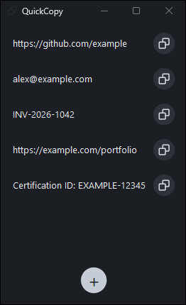
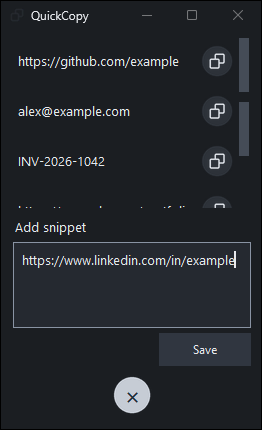
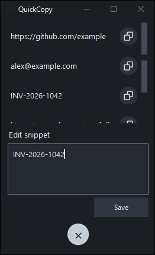

<div align="center">
  
  <h1>QuickCopy</h1>
  <p>A small Windows dock for the text you reuse.</p>
  <p><strong>Windows 10 / 11</strong> · <strong>Local storage</strong> · <strong>Private preview</strong></p>
  <p><a href="https://github.com/brianblong/QuickCopy/releases/tag/v0.3.0-preview.1">Download the v0.3 preview</a> · <a href="#use-it">Use it</a> · <a href="#build-from-source">Build from source</a></p>
  
</div>

QuickCopy keeps a short list of links, IDs, and other text close at hand. It opens near the lower-right of the current monitor, just above the taskbar, and stays out of the way until you need it.

## Download

**[Download QuickCopy.exe — Windows x64 preview](https://github.com/brianblong/QuickCopy/releases/download/v0.3.0-preview.1/QuickCopy.exe)**

The repository and preview are private. Sign in with an account that has access. The executable is unsigned and does not require Python.

1. Download `QuickCopy.exe` from the [v0.3.0-preview.1 release](https://github.com/brianblong/QuickCopy/releases/tag/v0.3.0-preview.1).
2. Put it in a permanent folder and open it.
3. Right-click the running taskbar icon and choose **Pin to taskbar**.
4. Close it and click the pinned icon to open it again.

The release includes `SHA256SUMS.txt`. Compare it with:

```powershell
Get-FileHash .\QuickCopy.exe -Algorithm SHA256
```

## Use it


The dock shows your saved snippets as compact rows. Click a row's copy button to copy the complete original text, including line breaks, Unicode, and surrounding whitespace. The button briefly changes to `Copied.`.

| Add a snippet | Edit a snippet |
| --- | --- |
|  |  |

- Click **+** to open the Add panel. **Ctrl+Enter** saves; **Escape** cancels.
- Double-click a snippet to edit it. You can also right-click it and choose **Edit**.
- Right-click a snippet and choose **Delete**, or open the menu with **Shift+F10** or the Menu key. Deletion asks for confirmation.
- Use the mouse wheel or scrollbar when the list is longer than the dock.
- Launching QuickCopy again focuses and restores the existing window instead of opening a second one.

The first run uses a few fictional examples. The screenshots in this repository were captured from the app with fictional data; no personal snippets are included.

## Local storage

Snippets are stored as plain-text JSON at:

```text
%LOCALAPPDATA%\QuickCopy\snippets.json
```

The app does not use accounts, sync, telemetry, or network services. Your snippets are outside this repository and are not bundled into the executable. They are not encrypted; anyone who can read your Windows profile can read them.

Saving is atomic. Malformed files and save failures show an error without silently replacing your data, and the editor keeps your text available for another attempt. To back up or restore snippets, close QuickCopy and copy `snippets.json`.

## Build from source

Python 3.12+ with Tcl/Tk on Windows is supported. The app itself uses only the standard library.

```powershell
git clone https://github.com/brianblong/QuickCopy.git
cd QuickCopy
git switch feat/quickcopy-desktop  # Until the initial draft PR is merged
py quickcopy.py
```

Build the standalone executable:

```powershell
powershell -NoProfile -ExecutionPolicy Bypass -File .\build.ps1
```

Without the `py` launcher, pass `-Python 'C:\path\to\python.exe'`. The script reuses the project `.venv` when possible, installs the pinned build requirements, and writes `dist\QuickCopy.exe`. Internet access is needed to install build dependencies.

Run the Windows tests:

```powershell
py -m unittest discover -s tests -v
```

The 15-test suite uses temporary storage and fictional text. It covers copy and clipboard survival, add/edit/delete persistence, duplicate rows, empty lists, keyboard interaction, scrolling, errors, startup placement, and same-title single-instance collisions.

## Repository

| Path | Purpose |
| --- | --- |
| [`quickcopy.py`](quickcopy.py) | Tkinter UI, Windows placement and clipboard ownership, local JSON storage |
| [`tests/test_quickcopy.py`](tests/test_quickcopy.py) | Windows behavior and regression tests |
| [`build.ps1`](build.ps1) | Repeatable executable build |
| [`assets/`](assets/) | App and button artwork |
| [`tools/generate_icons.py`](tools/generate_icons.py) | Regenerates checked-in icon assets |
| [`tools/capture_screenshots.py`](tools/capture_screenshots.py) | Developer-only native screenshot capture |
| [`CONTRIBUTING.md`](CONTRIBUTING.md) | Contribution and verification guidance |
| [`CHANGELOG.md`](CHANGELOG.md) | User-visible changes |
| [`docs/development/`](docs/development/) | Review, workflow, and release handoff records |

The repository remains private while the preview is being refined. Merging and any future public release stay with the owner.
