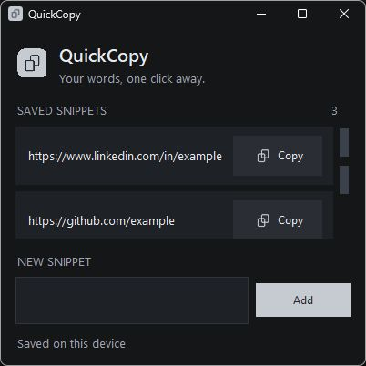
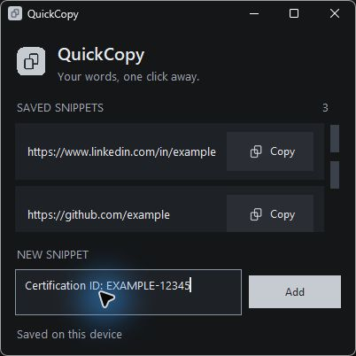
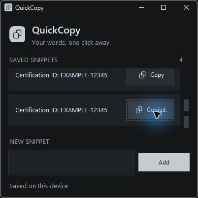

<div align="center">
  
  <h1>QuickCopy</h1>
  <p>Your words, one click away.</p>
  <p>A small Windows companion for the links, IDs, and text you copy every day.</p>
  <p><strong>Windows 10 / 11</strong> · <strong>Local storage</strong> · <strong>Private preview</strong></p>
  <p><a href="https://github.com/brianblong/QuickCopy/releases/tag/v0.2.0-preview.1">Download the Windows preview</a> · <a href="#how-it-works">How it works</a> · <a href="#development">Build from source</a></p>
  
</div>

## A clipboard shortcut that stays out of your way

Save a few useful snippets, pin QuickCopy to your taskbar, and copy what you need. The slim charcoal window opens near the bottom-right of the monitor where your pointer is, just above the taskbar's reserved area. It remains a normal movable, resizable Windows window.

- **One-click copy.** Each row has its own copy button and brief `Copied.` confirmation.
- **Full text, every time.** Long snippets, multiline text, Unicode, and leading/trailing whitespace are preserved. Copied text stays available after QuickCopy closes.
- **Save once, reuse later.** Add a snippet and it appears immediately; reopen the app and it is still there.
- **Small and familiar.** A 400 × 370 client area, a scrollable list, and a simple multiline input. No tray menus, account, or sync service.
- **One window.** Launching again restores the existing instance, including when minimized.

## Download and launch

**[Download QuickCopy.exe — Windows x64 preview](https://github.com/brianblong/QuickCopy/releases/download/v0.2.0-preview.1/QuickCopy.exe)**

This repository and its downloads are private. Sign in with an account that has access. Preview releases are for testing; the app is not yet a finished public release.

1. Download `QuickCopy.exe` from the [preview release](https://github.com/brianblong/QuickCopy/releases/tag/v0.2.0-preview.1). No Python installation is required.
2. Put it in a permanent folder, such as a QuickCopy folder on your Desktop, and double-click it.
3. Right-click its running taskbar icon and select **Pin to taskbar**. Depending on Windows, you may need to right-click the app name again.
4. Close it, then click the pinned icon to reopen. While it is running, the taskbar icon focuses/restores it.

Keep the executable at the same path after pinning. To update, close QuickCopy and replace the executable in that location. Your snippets are stored separately and survive updates. The release includes `SHA256SUMS.txt`; you can compare it with `Get-FileHash .\QuickCopy.exe -Algorithm SHA256`. Preview builds are unsigned.

## How it works

| Add your text | Copy it when you need it |
| --- | --- |
|  |  |

1. Paste text into **New snippet** and click **Add**. The field supports multiple lines; whitespace-only entries are ignored.
2. Find the saved row. Use the mouse wheel over the list or drag the scrollbar. Tab reaches the copy buttons and brings their rows into view.
3. Click **Copy**, then paste into your destination app. A row previews up to 160 characters, with line breaks displayed as spaces; copying always uses the complete original.

The first run includes fictional LinkedIn, GitHub, and certification examples. All screenshots use fictional sample data. This version focuses on adding, viewing, and copying; editing, deleting, and cloud sync are not included.

## Your snippets stay on your PC

Data is saved as plain-text JSON at:

```text
%LOCALAPPDATA%\QuickCopy\snippets.json
```

The app makes no network requests and has no telemetry. Personal snippets are outside this repository, excluded from Git, and never bundled in the executable. They are not encrypted; anyone who can read your Windows profile can read the file.

To back up, close the app and copy `snippets.json`. To restore, close the app and put the file back at the same location. A malformed file displays an error instead of being overwritten; back it up, then repair the JSON or rename it to start fresh. Save failures leave your input available for retry.

## Development

Python 3.12+ with Tcl/Tk on Windows is the supported development setup. The app itself uses only the standard library.

```powershell
git clone https://github.com/brianblong/QuickCopy.git
cd QuickCopy
git switch feat/quickcopy-desktop  # Until the initial draft PR is merged
py quickcopy.py
```

Build a standalone windowed executable:

```powershell
powershell -NoProfile -ExecutionPolicy Bypass -File .\build.ps1
```

Without the `py` launcher, pass `-Python 'C:\path\to\python.exe'` to the script. Use a base Python interpreter, not the `.venv` interpreter that the build script creates. The script installs pinned PyInstaller into `.venv` and produces `dist\QuickCopy.exe`, embedding the icons. Internet access is needed to install build dependencies.

Run the tests:

```powershell
py -m unittest discover -s tests -v
```

Tests create real Tk windows, use temporary snippet files, and replace the clipboard with test text. They cover exact copy, clipboard survival after process exit, Add and restart persistence, scrolling, compact layout, startup placement, malformed storage, and failed saves. They do not touch your saved snippet list.

## Project map

| File | Purpose |
| --- | --- |
| [`quickcopy.py`](quickcopy.py) | Tkinter UI, Windows positioning and clipboard ownership, local JSON storage |
| [`tests/test_quickcopy.py`](tests/test_quickcopy.py) | Focused Windows regression checks |
| [`build.ps1`](build.ps1) | Repeatable standalone executable build |
| [`assets/`](assets/) | App icon, copy glyph, and editable SVG artwork |
| [`tools/generate_icons.py`](tools/generate_icons.py) | Regenerates PNG/ICO assets; developer-only dependency: Pillow |
| [`CONTRIBUTING.md`](CONTRIBUTING.md) | Small-change workflow and checks |
| [`CHANGELOG.md`](CHANGELOG.md) | Preview changes |
| [`REVIEW.md`](REVIEW.md) | Independent reviewer findings and verification |
| [`WORKFLOW.md`](WORKFLOW.md) | Lead → reviewer → GitHub handoff record |

## Preview status

Core behavior is tested on Windows. Taskbar pinning, multi-monitor arrangements, and visual comfort at different display scales should be checked on your own PC. Issues and design feedback are welcome from invited collaborators; please use fictional examples instead of posting personal snippets.

The repository remains private while the design and behavior are being refined. Merging and any future public release stay with the owner.
